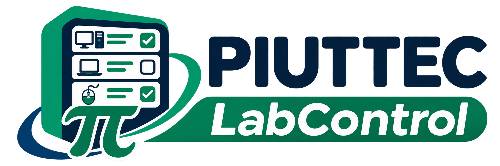

# PIUTTEC LabControl



Proyecto integrador de **TechnoManiacos** para el control de equipos de laboratorio de la DTIC de la Universidad Tecnológica de Tecámac.

## Equipo TechnoManiacos


## Estado

El primer avance incluye alta y consulta de equipos desde el panel adaptativo. El inventario usa SQLite de Android a través de un canal de Flutter. Cada instalación conserva sus propios registros.

Desde el panel, abre **Inventario** y pulsa **Registrar equipo**. Escribe un código único y el nombre del equipo. Puedes agregar su número de serie y buscar por cualquiera de esos tres datos. Los códigos se guardan en mayúsculas y SQLite impide duplicados.

Toca un equipo del listado para editar su ficha. Puedes agregar categoría, marca y modelo, y cambiar su estado a disponible, en mantenimiento o baja. El código de inventario sirve como identificador fijo. Para consultar o reactivar un equipo dado de baja, activa **Incluir equipos dados de baja**.

Desde una ficha, pulsa **Mostrar QR**. En el listado, pulsa **Escanear QR** y apunta al código con la cámara. El QR identifica al equipo por su código de inventario y abre su ficha si está registrado en el dispositivo. Los equipos dados de baja también conservan su QR.

Desde **Préstamos → Nuevo préstamo**, selecciona de uno a 25 equipos disponibles, ingresa el nombre del solicitante, destino y fecha límite opcionales. Todos los equipos seleccionados reciben **un folio común**, y la operación se confirma por completo o se cancela sin grabar ninguno si algún equipo deja de estar disponible. Las devoluciones, incidencias y prórrogas se hacen por equipo dentro del folio; el folio se considera cerrado cuando todos los equipos han sido devueltos.

SQLite conserva el inventario existente al actualizar la base local. La sincronización entre dispositivos sigue pendiente.

## Usuarios, roles e inicio de sesión local

La versión **SQLite v6** añade la tabla \`local_users\` sin alterar equipos, préstamos, folios, incidencias o respaldos previos. Al iniciar por primera vez esta versión, la aplicación solicita crear un **administrador**. No hay usuarios ni contraseñas predefinidos. Después, se requiere iniciar sesión para acceder a los registros.

| Rol | Inventario | Préstamos, devoluciones y bitácora | Historial | Respaldos y usuarios |
| --- | --- | --- | --- | --- |
| **Administrador** | Consultar y modificar | Consultar y operar | Consultar | Administrar |
| **Operador** | Solo consultar | Consultar y operar | Consultar | Sin acceso |
| **Consulta** | Solo consultar | Solo consultar | Consultar | Sin acceso |

La autorización se verifica **en los canales nativos Kotlin antes de ejecutar operaciones SQLite**; no se limita a esconder botones. El administrador puede crear otras cuentas locales (administrador, operador o consulta) y desactivarlas; no puede desactivar su propia sesión ni dejar el dispositivo sin administradores activos. Cada usuario puede cambiar su contraseña indicando la anterior. Las sesiones viven en memoria y se cierran al reiniciar el proceso o pulsar **Cerrar sesión**.

**Protección y límites:** las contraseñas se derivan con **PBKDF2-HMAC-SHA256, sal individual aleatoria y 210 000 iteraciones** y no se guardan ni exportan en texto plano. Los datos del laboratorio están en SQLite local **sin cifrado de base de datos**; los respaldos JSON tampoco están cifrados. Se deshabilita el respaldo automático Android para evitar copiar credenciales por ese mecanismo. El sistema exige 10 a 128 caracteres para contraseñas; tras cinco intentos fallidos se bloquea el inicio de sesión durante un minuto en el proceso actual.

Los **respaldos JSON v3 no incluyen cuentas ni contraseñas**, de modo que otro dispositivo conserva sus propios usuarios locales. Aún no hay recuperación de contraseña perdida, sincronización de usuarios, auditoría de accesos ni **flujo institucional de aprobación de préstamos**. Protege las contraseñas del administrador: una cuenta perdida no se recupera mediante JSON. Para producción se recomienda cifrado de datos, política de acceso a dispositivos y pruebas de seguridad antes de usar información personal real.

## Alcance del piloto

- **Implementado:** cuentas locales con tres roles y contraseñas derivadas mediante PBKDF2; inventario local con código único, QR, estados y baja lógica; préstamos de uno a 25 equipos bajo un folio y devoluciones individuales; historial local de esos movimientos, exportación y restauración de datos en una instalación vacía y resumen operativo de indicadores; fechas límite, prórrogas e incidencias de préstamos.
- **Pendiente:** aprobación institucional de préstamos; fotografías y ubicación de entrega/recepción; auditoría de cambios de inventario; sincronización segura entre dispositivos, aprobaciones formales, auditoría de accesos y reportes exportables.
- **Importante:** cada dispositivo conserva sus propios registros. El resumen y el historial presentan únicamente los datos locales; aún no existe una base central compartida.

## Historial de movimientos

Abre **Historial** desde el panel principal para consultar los eventos de préstamo y devolución guardados en la SQLite de este dispositivo. Cada equipo prestado muestra la fecha de entrega y, si ya fue devuelto, aparece un segundo evento con la fecha de devolución. Varios equipos pueden compartir el folio, pero conservan IDs individuales para devolverlos y registrar incidencias. La lista se ordena desde el evento más reciente.

Puedes buscar por folio, código, equipo, solicitante o destino; filtrar por **Todos**, **Préstamos** o **Devoluciones**, y tocar un registro para abrir sus detalles. El botón de actualizar vuelve a consultar la base local.

**Alcance actual:** este historial solo reconstruye préstamos y devoluciones. Las incidencias y prórrogas se consultan en la bitácora de cada folio; las altas o ediciones de inventario aún no tienen auditoría. Tampoco se sincronizan datos entre instalaciones. La migración v6 para cuentas locales conserva estos datos y no pide permisos Android adicionales.

## Préstamos de varios equipos por folio

La aplicación utilizó SQLite **v5** para folios compartidos y ahora **v6** para cuentas locales; en v5 añade la columna `folio` a la tabla `loans` y rellena los préstamos antiguos con `folio = id`, sin borrar movimientos existentes. El identificador `id` sigue perteneciendo a cada préstamo de equipo, mientras `folio` agrupa los artículos entregados en una misma operación.

Al crear un préstamo se pueden seleccionar **1 a 25 equipos**. Kotlin verifica los códigos y la disponibilidad dentro de una **única transacción SQLite**; si falla un equipo, no se entrega ninguno. Los integrantes del folio comparten solicitante, destino, fecha de entrega y fecha límite inicial.

En **Préstamos** aparece una tarjeta por folio, con cantidad de equipos activos y devueltos. Se puede devolver un solo equipo y conservar los demás activos. Los cambios posteriores de vencimiento y la bitácora de incidencias siguen siendo **por equipo**, no por todo el folio. El historial permite buscar el folio común.

Los respaldos **JSON v3** preservan las agrupaciones, préstamos individuales y eventos. La restauración sigue aceptando JSON v1/v2, asignando en esos casos un folio distinto a cada registro. La restauración solo funciona en una instalación vacía; no combina registros entre dispositivos.

## Fechas límite, prórrogas e incidencias de préstamos

En **Nuevo préstamo** puedes definir una fecha límite opcional (hasta el final del día seleccionado). Los préstamos anteriores no tienen vencimiento asignado automáticamente. Los préstamos activos con fecha vencida se marcan **VENCIDO** en la lista.

En un folio abre **Plazos e incidencias** para ampliar la fecha límite y guardar un motivo, o para registrar incidencias con una descripción de hasta 500 caracteres. La bitácora guarda fecha, tipo, motivo y vencimiento anterior/nuevo de cada prórroga. No permite prorrogar folios devueltos; las incidencias registradas permanecen consultables después de la devolución.

La base local migró de **SQLite v3 a v4** para agregar fechas e incidencias, y ahora de **v4 a v5** para agrupar equipos sin eliminar registros existentes. Los respaldos **JSON v3** incluyen la fecha límite, bitácora y folio común; también se pueden importar respaldos v1/v2 en instalaciones vacías. No implica autorización institucional ni sincronización entre dispositivos.

## Resumen operativo del laboratorio

El panel principal muestra cifras reales obtenidas del inventario y los préstamos de la SQLite local: **equipos registrados, disponibles, en préstamo, mantenimiento, baja, folios activos** y el número de **folios completados**. Los cuatro estados de equipos se cuentan de forma excluyente para evitar duplicados.

El resumen dispone de **Actualizar indicadores** y se recarga automáticamente cuando regresas desde Inventario, Préstamos, Historial o Respaldos. Si aún no hay equipos, presenta un estado vacío; si falla una lectura, ofrece un botón para reintentar. Los valores no se sincronizan entre dispositivos.

## Respaldos y restauración local

En el panel principal abre **Respaldos**:

- **Exportar respaldo:** elige una carpeta con el selector de documentos de Android. La app genera un archivo JSON con el inventario, estados, folios, solicitantes, destinos, préstamos activos y devueltos y sus fechas.
- **Restaurar respaldo:** selecciona un JSON generado por PIUTTEC LabControl. Esta función **solo se permite si la SQLite local está vacía**, con el fin de no sobrescribir registros existentes ni mezclar folios. Se valida formato, límites de campos, códigos y folios únicos, claves foráneas y préstamos activos; los datos se insertan en una transacción.
- **Seguridad:** el JSON contiene datos personales de solicitantes y **no está cifrado**. Guárdalo en un destino privado y elimínalo de carpetas compartidas. No se envía automáticamente a ningún servicio.
- **Compatibilidad:** exportación v3 e importación v1/v2/v3, máximo 8 MB. Android utiliza el selector nativo de documentos (SAF); no requiere permiso general de almacenamiento. No incluye fotos ni adjuntos externos.

Para comprobar la recuperación, utiliza un emulador o dispositivo de pruebas con una **instalación vacía**; no desinstales ni borres los datos de una instalación con información real para probar la restauración.

## Ejecutar en Android

Para reproducir la compilación de GitHub Actions, usa Flutter 3.50.1, el SDK de Android y un JDK compatible con el proyecto (17 o superior). Conecta un dispositivo con depuración USB o inicia un emulador.

```bash
flutter doctor -v
flutter pub get
flutter run
```

## Estructura

| Ruta | Responsabilidad |
| --- | --- |
| `lib/main.dart` | Punto de entrada |
| `lib/app.dart` | Configuración de Material y tema |
| `lib/features/dashboard/` | Pantalla inicial del laboratorio |
| `lib/features/inventory/` | Alta, listado, búsqueda y acceso al canal de inventario |
| `android/` | Integración nativa e íconos de lanzador |
| `assets/branding/` | Ícono de marca |
| `test/` | Pruebas de interfaz |

## Colaborar

Crea una rama por cambio y abre un pull request hacia `main`. Usa datos ficticios para pruebas y capturas. Mantén las llaves, credenciales, archivos SQLite y evidencias reales fuera del control de versiones.

```bash
dart format --output=none --set-exit-if-changed lib test
flutter analyze
flutter test
```
